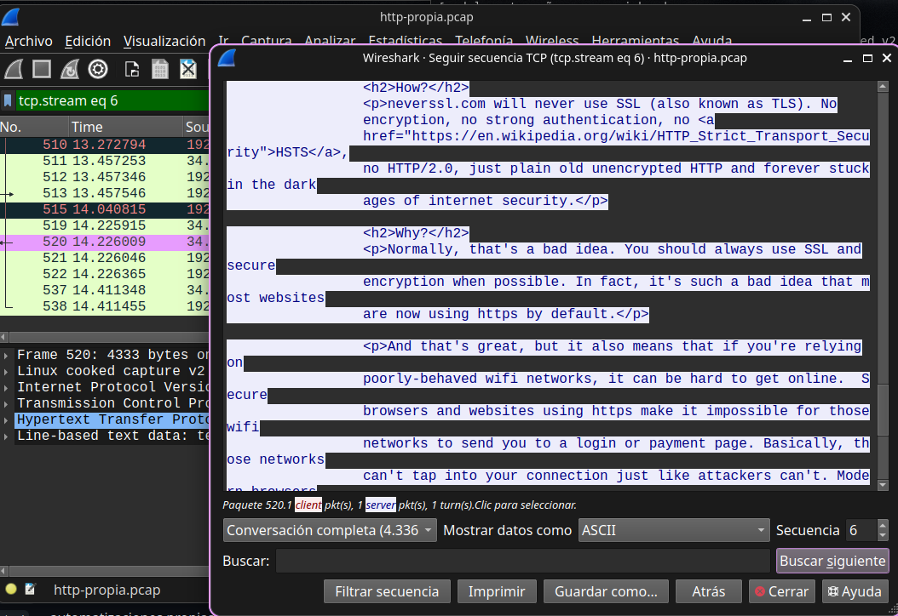

# Writeup 01 — Tráfico HTTP en claro

**Fecha:** 2026-11-02
**Herramientas:** tcpdump, Wireshark, curl
**Captura:** `capturas/http-propia.pcap`
**Objetivo:** identificar hosts, puertos y contenido visible en HTTP sin cifrar.

## Respuestas

1. **IPs.** Mi equipo: `192.168.1.14`, rango privado (RFC 1918), no enrutable en internet.
   Servidor: `34.223.124.45`, IP pública (AWS). Lo confirmé porque el paquete marca `source` y `destination`, y porque la primera es privada.
2. **Puertos.** Origen `48738`, destino `80`. El origen es un puerto **efímero**: el sistema operativo lo asigna al azar para esa conexión, porque el 80 ya está ocupado por el servidor y así puede haber varias conexiones simultáneas.
3. **Métodos.** Solo `GET`.
4. **User-Agent.** `curl/8.5.0`. Delata la herramienta: curl, no un navegador.
5. **Texto claro.** Sí: se ven `Host`, ruta y contenido. Al no estar cifrado, cualquiera que capture el tráfico en el camino puede leerlo.

## Evidencia

## Conclusión

HTTP expone el contenido de la petición: host, ruta, headers y cuerpo. HTTPS cifra ese contenido, pero un observador sigue viendo la IP de destino, el puerto y el dominio resuelto por DNS. Por eso HTTPS protege el qué, no el a dónde.

## Dudas abiertas

Lo que me costo entender en si fue la informacion que entrega Wireshark.
